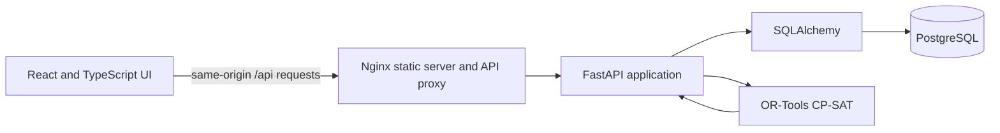

# DataStraw Smart Roster — Project Record

This document tells the project story from assessment analysis through implementation, deployment, testing, and remaining trade-offs. It combines the assessment, the implementation plan in [`requirement.txt`](requirement.txt), the current codebase, and the checks run against it. It records decisions that are evidenced by those sources; it does not claim that an exhaustive benchmark of every possible stack was performed.

## 1. The assignment and the problem we chose to solve

The assessment asks for a browser-based monthly roster tool for an operations team supporting multiple direct-to-consumer brands. Employees belong to pods, have different skills and availability, and may support one or more brands and processes. Brand/process combinations can have different operating calendars and staffing needs. A change such as an approved absence can affect coverage on more than one account.

The key observation was that this is a **constraint-based resource allocation problem**, not just a calendar or spreadsheet replacement. A roster can look complete while assigning an unqualified person, double-booking an employee, violating a leave request, or leaving a required process uncovered. The project therefore treats a schedule as acceptable only after it has been checked against the configured rules.

The assessment explicitly leaves the technology stack open. It prioritizes correct scheduling and clear conflict detection over adding complexity. It also requires a public application that reviewers can use without installing the development environment, realistic sample data, source/setup documentation, and a short demonstration.

### Core requirements translated into product decisions

- Model employees, pods, brands, processes, skills, eligibility, availability, and roster assignments as separate concepts.
- Generate a month of work from configurable data instead of hard-coding employee/date scenarios.
- Respect calendars, approved time off, skills, eligibility, employee capacity, and minimum/maximum staffing.
- Show gaps and explain them when all requirements cannot be met; never pretend an uncovered slot is staffed.
- Provide company, pod, brand, process, and employee perspectives, plus validated manual edits.
- Let a manager review changes and replacements before applying them, and preserve unaffected assignments during targeted replans.
- Use fictional assessment data and label it as demo assumptions rather than company policy.

## 2. Architecture and technology decisions

The selected stack keeps the user interface, API, relational data, and optimization logic in one understandable application release.

| Area | Choice | Why it fits this project |
|---|---|---|
| Frontend | React + TypeScript + Vite | The interface has many filters, forms, roster views, and editing states. React supports those interactions; TypeScript helps keep API response and view shapes consistent. Vite gives a compact development and production build. |
| Backend | Python + FastAPI + Pydantic | The scheduling and optimization libraries are Python-first. FastAPI exposes typed HTTP endpoints, while Pydantic validates incoming configuration before it reaches the database. |
| Scheduling | Google OR-Tools CP-SAT | Roster choices are discrete assignments subject to many hard constraints and soft preferences. CP-SAT can maximize feasible coverage while balancing tie-breakers, and can return a feasible partial plan when full coverage is impossible. |
| Persistence | PostgreSQL + SQLAlchemy | Employees, pods, skills, eligibility, calendars, assignments, and roster runs have many relationships and need foreign keys, unique constraints, transactions, and durable hosted storage. SQLAlchemy provides the relational mapping and query layer. |
| Web serving | Nginx serving the built frontend and proxying API paths | The frontend can be served as static files while `/api/` and `/health` are forwarded to the backend. A configurable upstream lets the same frontend container work locally and on Railway. |
| Packaging/hosting | Docker multi-stage images and Railway | The API and frontend can build from the same repository as separate services, with Railway PostgreSQL providing persistent data storage. The API and web server remain separate processes; the solver is a module in the API, not a separate microservice. |

The brief permitted many languages, frameworks, databases, and deterministic or AI-assisted schedulers. The project chose the smallest stack that directly supports the hard part: Python for the solver, a typed web API and UI for manager workflows, and a relational database for connected operational records. PostgreSQL was a project choice, not a requirement from the assessment. It was selected because a brand/process assignment depends on multiple related records and the application needs transactions and referential integrity as configuration changes. It also fits the managed database available in the deployment environment. SQLite is used only for isolated automated tests and local end-to-end smoke runs; it is not the hosted source of truth.

No Redis, search service, LLM, or standalone solver service was added. The assignment did not demonstrate a need for those systems, and deterministic solver output plus rule-based explanations is easier to validate and defend in an operations roster than generated assignments or explanations.

## 3. Domain model and relationships

The data model separates membership, qualification, eligibility, demand, and actual assignments so that one relationship cannot accidentally stand in for another.

- **Employee** stores an employee code, name, job title, active status, primary pod, and whether the person is configured as a pod lead. Related records store skills, weekly offs, work contract, availability exceptions, and preferences.
- **Pod** stores a team and its lead. An employee has one primary pod and may also have explicit cross-pod memberships. Membership makes a person available to work in that pod's window; it does not grant a skill or eligibility.
- **Pod schedule** stores the work window, lunch interval, and allocatable hours. The seeded Day Window is 09:00–18:00 with a 13:00–14:00 break; the Late Window is 13:00–22:00 with a 17:00–18:00 break. Each has a six-hour work-allocation cap. The windows overlap, so a person cannot be assigned to both overlapping windows on the same date.
- **Process** is a configurable work type with a code, name, description, required skill, default effort, and enabled state. The starting catalog has CS, ACC, Retention, and NDR.
- **Brand** stores the client account and whether it is active. Brand priority, client tier, deadline date, and manager note are stored separately so deadline urgency can influence tie-breaking without overriding hard constraints.
- **Brand/process rule** links one brand to one process. It defines the required skill, operating weekdays, holiday behavior, effort per person, demand units where configured, whether same-day sharing is allowed, and whether continuous presence is required. It also owns coverage and employee-eligibility records.
- **Coverage requirement** stores minimum and optional maximum distinct headcount for each weekday of a brand/process rule.
- **Employee eligibility** is an explicit many-to-many relationship between an employee and a brand/process rule. It records primary or backup status and whether the relationship is active. Pod membership and skill do not automatically create eligibility.
- **Availability exception** records leave, comp-off, or explicit unavailability with date range, approval status, and note. Approved exceptions block assignments; pending requests warn but do not block the solver.
- **Roster run** represents one generated month and tracks draft/published status and a snapshot of the generation settings.
- **Roster assignment** links one roster run, date, brand/process rule, and employee (or null for an uncovered slot), with effort, status, explanation, and optional half-hour allocation units.
- **Employee roster day** records each employee's daily state, such as working, off, leave, or available but unassigned.
- **Generation report and validation results** record coverage totals, solver status, uncovered slots, warnings, and hard-rule issues so that the UI can distinguish a complete roster from a partial one.

This model answers the assessment's relationship question: a brand has many processes through brand/process rules; employees gain a skill independently; explicit eligibility connects them to a rule; pod membership and work window further restrict candidates; and a dated roster assignment is created only after those inputs are considered.

## 4. Demo data and assumptions

The seed data is deliberately fictional and configurable. An isolated seed run produced 30 employees, 2 pods, 15 brands, 4 processes, 18 brand/process rules, and 72 explicit eligibility links. Twelve brands (80%) have a single primary owner; three have multiple primary owners. Other employees provide explicitly qualified backup capacity. The data includes separate-process ownership, shared-process coverage, a cross-pod backup, and a no-qualified-backup case.

The default work pattern allows at most five scheduled days per Monday–Sunday week, a two-day minimum off pattern, six allocatable effort hours per day, and 40 weekly hours for most seeded employees (45 for CS-skilled staff). Because the daily allocation cap and five-day cap are lower in combination, a typical default employee can receive at most 30 scheduled effort hours in a full week. These numbers demonstrate constraint behavior and are not represented as real DataStraw labor policy.

The seeded calendar examples include seven-day operation including holidays, seven-day operation excluding holidays, and Monday–Saturday operation excluding holidays. Managers can configure weekday and holiday rules individually. The app can import a Maharashtra state-government holiday calendar on startup when its feed is available; feed errors are tolerated so startup does not depend on the external calendar service. Managers can maintain holidays in the app as well.

### Single-resource and multi-resource brands

“Single-resource” means one primary owner, not that the system forbids backups. A qualified backup from another brand or pod may cover the owner’s weekly off or leave only if that person has the required skill, explicit eligibility, pod membership, availability, and capacity. Multi-owner brands have multiple primary or backup relationships. Some brands split processes among employees; others share the same process across several employees. Each process/date is solved as its own demand, while shared employee capacity prevents the same person from being over-allocated across work.

This is the answer to how single- and multi-employee brands are handled: the data model and solver are the same for both. The number and type of eligible employees differ in configuration, rather than requiring a special code path for a brand with one or several people.

## 5. How roster generation works

### Layer 1: day-level coverage

The backend reads active employees, skills, contracts, weekly offs, approved exceptions, brand/process rules, coverage requirements, holidays, eligibility, pod membership, and work windows. It creates a dated coverage slot for each required headcount unit, then builds candidate assignment variables for employees who satisfy all hard candidate rules.

The CP-SAT model enforces:

1. Only active employees with the required skill and active primary/backup eligibility can be assigned.
2. No assignment during weekly offs, approved leave, approved comp-off, explicit unavailability, or a closed brand/process day.
3. Daily and weekly effort limits, maximum scheduled days, and pod-window allocation capacity.
4. Minimum staffing and configured maximum staffing.
5. No incompatible overlapping-window double-booking and no disallowed same-day sharing.
6. In targeted replans, preservation of assignments outside the affected dates unless the manager requests a broader replan.

The main objective is maximum required coverage without breaking a hard rule. When coverage ties, the solver considers deadline priority, primary-owner preference, disruption to an existing plan, workload balance, Sunday/holiday balance, and configured employee preferences. These are soft preferences: they cannot justify leaving otherwise feasible required coverage empty.

The model returns a partial draft when staffing is infeasible rather than assigning an invalid person. Each unfilled slot receives an explanation based on the candidate blockers, such as missing skill/eligibility, an absence, a work-window mismatch, or capacity contention. A partial draft is visibly distinct from a complete roster.

### Layer 2: optional half-hour allocation

The optional hours layer adds a configurable half-hour allocation model. Defaults are 12 half-hour capacity units (six hours) per employee/day, one-unit minimum task chunks, at most two brands per employee/day, and a configurable solver time limit. It tries to satisfy the minimum staffing floor first, then allocates priority-weighted demand above that floor while honoring shared daily/weekly capacity and the hard rules. The manager can enable or disable this layer. If it is disabled, infeasible, times out without a usable answer, or fails independent validation, the valid Layer 1 draft is retained. Generation snapshots the settings used for auditability.

### Independent validation and publishing

Solver output is never trusted as proof of correctness. A separate validator re-reads the saved roster and current input records and checks staffing, eligibility, skills, working calendars, availability, capacity, sharing, and overlapping windows. Generation and manual edits invoke validation. Hard-rule violations block the operation or publication. Uncovered slots can remain in a partial roster; publishing them requires fresh validation and explicit manager confirmation, with gaps clearly disclosed.

This answers how the system decides whether a roster satisfies requirements: the optimizer proposes assignments; an independent validator checks the persisted result; the UI reports complete, partial, warning, or needs-attention status and concrete issues.

## 6. Absences, conflicts, and human review

If a sole primary owner becomes unavailable on a required day, the system does not override the absence or silently leave the slot marked as covered. It searches all qualified, eligible, active, available employees who fit the pod window and capacity. If a candidate can safely cover the work, the manager sees a ranked suggestion and approves the replacement. If none can, the slot remains uncovered with an explanation. A seven-day requirement cannot be met by a single five-day employee without a qualified backup; the application must make that limitation visible.

When availability or a brand/process rule changes after generation, the API determines affected dates. Candidate lookup filters out employees who fail eligibility, skill, availability, capacity, pod membership, or window-overlap rules. A targeted replan preserves unaffected assignments, and a preview shows recommendations and coverage before applying them. Manual edits are also checked before they can be treated as valid.

Hard constraints include qualifications, explicit eligibility, availability, calendars, staffing maximums, and capacity. Preferences include preferred weekdays, primary-owner preference, fairer workload, holiday/Sunday balance, and deadline priority when two plans cover the same total number of slots. Missing staffing is reported rather than “fixed” by violating a hard rule. This is the answer to how conflicts and insufficient staffing are handled.

### What is automated and what remains under manager control

Automated: candidate filtering, monthly allocation, hard-rule validation, gap detection, explanation templates, affected-date calculation, replacement ranking, and targeted replan proposals.

Manager-controlled: configuration of employees/skills/eligibility/calendars, approval status for leave, choosing whether to accept a replacement, manual edits, accepting partial-roster gaps, and publishing. This division automates repetitive constraint checking while leaving policy choices and consequential roster approval with a human.

## 7. Product and API workflows

The React interface provides navigation for Roster, Daily assignments, Employee calendar, People & leave, Pods, and Brands. It includes company/pod/brand/process/employee filtering, month selection, draft generation, assignment editing, configuration forms, roster history/undo-redo, coverage and validation status, absence entry, replacement options, and replan preview/confirmation.

The FastAPI layer exposes health, summary, resource configuration, roster generation, roster listing/detail, validation, publish, assignment edits, availability changes, replacement candidate, and replan endpoints. Pydantic request models validate dates, integer ranges, weekdays, capacities, staffing, and configuration boundaries before database writes. SQLAlchemy transactions persist changes; the app applies additive schema upgrades during startup.

## 8. Development path and decisions made along the way

The implementation followed the staged plan in `requirement.txt`:

1. **Make the problem explicit.** Translate the prompt into separate business entities, constraints, configurable defaults, edge cases, and acceptance criteria. Keep synthetic assumptions distinct from verified company policy.
2. **Build the foundation and sample data.** Create the relational model and seed a 30-person, multi-pod, multi-brand dataset with single-owner, multi-owner, shared-process, cross-trained, and no-backup examples.
3. **Solve the core allocation problem first.** Use CP-SAT to create monthly assignments, employee-day states, and explicit uncovered slots. Favor feasible total coverage over preferences.
4. **Add a separate validator.** Check saved output independently and make hard violations and incomplete coverage distinct. This prevents a solver result from being treated as valid merely because it was generated.
5. **Add manager workflows required by the assessment.** Build configuration, views, filtering, manual edits, publish confirmation, absence handling, candidate suggestions, and targeted replanning.
6. **Add the time-window and priority extension.** Keep one primary pod while allowing explicit cross-pod membership. Map each brand/process to a window; enforce overlapping-window conflicts in both solver and validator. Add deadline priority only as a tie-breaker after total coverage.
7. **Add optional half-hour allocation.** Keep the original staffing allocator as a fallback so the optional optimization cannot replace a valid basic draft with a failed advanced result.
8. **Deploy and verify the integration.** Build a frontend container and API container, proxy API calls through Nginx, use Railway’s managed PostgreSQL, and configure service-to-service routing. The browser uses the web URL; it does not connect directly to the database.
9. **Reconsider authentication for the assessment.** Clerk was tried during development, but the assessment does not require authenticated accounts and asks for a public app reviewers can test without setting up a dev environment. Managing unknown reviewers’ accounts and role metadata would add friction. Clerk was removed and the selectable Manager/Pod lead/Employee preview was restored so reviewers can explore role views directly. This is a demo convenience, not secure authentication.
10. **Add a central write guard.** API middleware now blocks POST/PUT/PATCH/DELETE when the selected demo role is Employee or Pod lead, preventing those UI roles from reaching manager write workflows through ordinary app use. HTTP tests cover that rule across methods.

### Deployment and access decision

The current development demo is hosted at [`https://roaster-system-development.up.railway.app`](https://roaster-system-development.up.railway.app). The repository remote is [`https://github.com/vrindaatalwar/roaster-system`](https://github.com/vrindaatalwar/roaster-system). Closing Railway’s dashboard does not stop a running deployment; service/account state still determines availability. Confirm the latest Railway deployment is green before submission.

The demo role selector sends role and employee identity headers to the API. Those headers are user-controlled, so a visitor can select Manager or change an employee identity. The central write guard is not authentication and does not prevent a visitor from choosing Manager. This is acceptable only for a public assessment demo with fictional data. Do not put actual employee or client information in it. Add trusted authentication and server-side identity binding before any real operational use.

## 9. Testing and observed results

The repository contains 64 backend tests covering management validation and CRUD, solver/validator agreement, infeasible demand, public holidays, leave states, weekly offs, cross-pod membership, windows, deadline priority, capacity, manual edits, publication, replanning preservation, HTTP role scoping, CORS preflight, and manager-only write verbs. The final recorded run passed all 64 tests. The React/TypeScript production build also completed successfully. `git diff --check` passed for the role-write guard change.

An additional isolated SQLite end-to-end smoke run used the complete fictional seed and generated the current month: 421 required slots, 417 filled, and 4 uncovered. The resulting status was `needs_attention`, and independent validation found zero hard-rule violations. The four uncovered slots demonstrate the intended partial-roster behavior; they should remain visible and be explained, not hidden or mislabeled as covered. This run verifies the data-to-solver-to-validator path locally, not Railway database performance.

SQLite is used in these tests to avoid changing the hosted database. The API integration tests exercise the HTTP middleware and representative summary scopes. The solver tests include deterministic fixtures and randomized small worlds. A full production load test or legal working-time validation has not been performed.

## 10. Limitations and deliberate exclusions

- Demo roles are not trusted identities. Role and employee headers can be changed by the caller.
- Seed data and calendar policy are fictional. The app is not using real DataStraw schedules or service-demand history.
- Demand is configured by managers; the app does not forecast it from sales, call volume, or historical ticket data.
- Work windows are workload/collision boundaries. V1 does not schedule exact start/end times for every task or guarantee continuous intraday coverage.
- The solver counts assignments in the selected month for partial weeks; it does not include work before or after that month when checking a week boundary.
- No labor-law compliance, overtime, payroll, attendance, labor-cost optimization, leave entitlement, automatic holiday compensation, or minimum rest-between-shifts validation is claimed.
- There is no employee self-service portal, automatic approval, notification service, or automatic publishing.
- Schema upgrades are small additive startup migrations; the project does not yet use a full migration history tool such as Alembic.
- Solver timings vary by machine. The 60-second configured layer-two limit is a demo limit, not a production service-level guarantee.

## 11. The assessment’s eight reflection questions, answered in context

1. **How are employees, brands, processes, pods, and their relationships modeled?** Section 3 describes the relational model. The key separation is between skill, explicit brand/process eligibility, pod membership, and actual dated assignments.
2. **How does the system generate and validate a roster?** Section 5 describes the CP-SAT allocation, hard constraints, soft preferences, partial results, and independent validation.
3. **How are single-resource and multi-employee brands handled?** Section 4 explains that they use the same model; the difference is primary and backup eligibility data, not special-case code.
4. **What happens when a sole owner is unavailable?** Section 6 covers qualified backup search, manager approval, and an explicit uncovered slot when no safe candidate exists.
5. **How are conflicts or insufficient staffing handled?** Sections 5 and 6 describe hard-rule validation, explanations, partial drafts, and publish guardrails.
6. **What is automated and what remains human-controlled?** Section 6 separates solver/validation/recommendation work from manager configuration, approvals, editing, and publishing.
7. **What would change if the team and brand count doubled?** Add query indexes and pagination where measured, move long solves to queued background jobs with visible status, profile solver model growth, strengthen database migrations, and add larger benchmark fixtures. Keep constraints and independent validation centralized; split services only if measured load requires it.
8. **What would be improved first with one more week?** Prioritize an assessment-ready demo/reset walkthrough and broaden integration/performance checks with more generated inputs. If the product were moving beyond fictional data, the first prerequisite would be trusted authentication and identity binding; exact task-time/rest rules would follow only when policy and input data are defined.

## 12. Submission readiness

The application and source repository are available at the links in Section 8. This document provides the detailed approach record and can be shortened into the assessment’s approach note. Before sending the assessment submission, still confirm:

- The latest Railway deployment is successful and the public URL opens in a fresh browser session.
- The GitHub repository is visible to the reviewers and includes the current source, README, setup guidance, and `.env.example`.
- A 3–5 minute video demonstrates generation, different calendars, validation/conflicts, a successful backup/replan, and a no-backup gap.
- The LinkedIn URL is accessible and included.
- The submission email includes the app URL, repository, LinkedIn URL, and a short approach summary.

Do not include Railway or database secrets in this document, the repository, the video, or the submission email.
